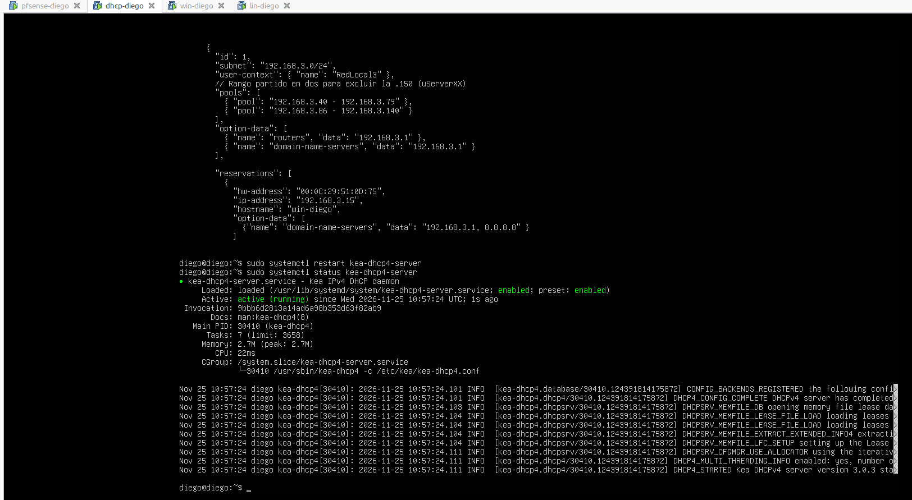
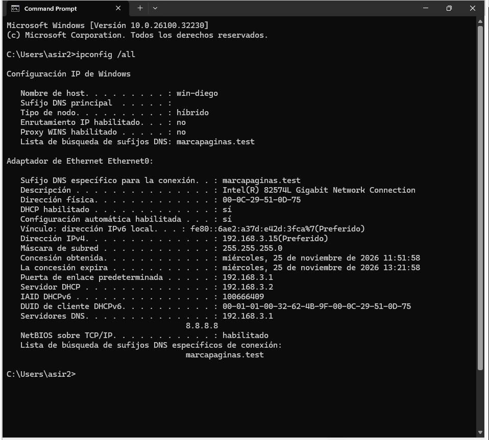
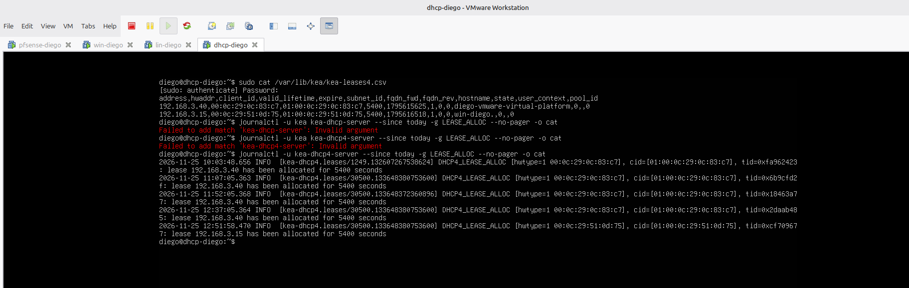

# UT2 · Servicio DHCP de Libreria El Marcapaginas

| Dato | Valor |
|---|---|
| Nombre | Diego|
| Nº de orden (xx) | 3|
| Empresa | Libreria el marcapaginas|
| Dominio | marcapaginas.test|

> Rellena los huecos y sustituye los textos entre `< >`. No cambies el orden de los apartados: es el mismo que el de la lista de cotejo.

## Plan de direcciones

| Equipo | Hostname | MAC | Dirección IP | Cómo la obtiene |
|---|---|---|---|---|
| Router pfSense (LAN) | pfsense-diego| fe80::20c:29ff:fe13:cf90 | 192.168.3.1 | Manual |
| Servidor DHCP | dhcp-diego | fe80::20c:29ff:febc:4c4a/64| 192.168.3.2 | Manual (fija) |
| Equipo de dirección (Windows) | win-diego | 00:0C:29:51:0D:75 |192.168.3.100| Ip reservada|
| Puesto de trabajo (Linux) | lin-diego | fe80::20c:29ff:fe0c:83c7/64 | 192.168.3.40| Ip dinámica| 

| Parámetro | Valor |
|---|---|
| Pools | .40 - .140|
| Exclusión | .80 - .85|
| Concesión / T1 / T2 (s) | 5400|
| DNS del equipo de dirección | 8.8.8.8|

## 1. Instalación del servidor · CE 2.c

**Qué demuestra:** En esta captura encontramos arriba a la izquierda el hostname de la maquina que es llama dhcp-diego, arriba podemos ver que el servidor kea esta activo y funcionando y debajo podemos ver la ip configurada.

## 2. Configuración básica · CE 2.d

La configuración completa está en [kea/kea-dhcp4.conf](kea/kea-dhcp4.conf).

**Qué demuestra:** En esta captura se demuestra que el servidor kea esta activo y funcionando.

**Qué demuestra:** En esta captura podemos ver que el hostname de la maquina es lin-diego, que la ip esta dentro de la pool y que se llama ens33.

**Qué demuestra:** En esta captura se puede ver que el servidor que responde es el kea que esta funcionando.

## 3. Asignaciones dinámicas y estáticas · CE 2.e

**Qué demuestra:** <una frase>

**Qué demuestra:** <una frase>

## 4. Opciones adicionales · CE 2.f

Se comprueban en `kea-dhcp4.conf` (con el comentario junto a la reserva), E4 y E5. No hace falta nada más aquí.

## 5. Así funciona una solicitud · CE 2.b

**Qué demuestra:** <una frase>

| Mensaje | IP origen | MAC origen | IP destino | MAC destino | Difusión o unicast |
|---|---|---|---|---|---|
| DISCOVER | | | | | |
| OFFER | | | | | |
| REQUEST | | | | | |
| ACK | | | | | |

- **xid:**
- **Identificador del servidor:**

**Renovación y caducidad** (con tus tiempos, 3 o 4 líneas):

## 6. Informe para la empresa · CE 2.a

**Tres ventajas para <empresa>:**

1.
2.
3.

| Mecanismo | Cómo obtiene el equipo su IP | Qué equipo de la oficina lo usa (en APIPA, cuándo aparece) |
|---|---|---|
| Configuración manual | | |
| DHCP dinámica | | |
| Reserva DHCP | | |
| APIPA (169.254.x.x) | | |

**Por qué el router y el servidor DHCP no usan DHCP:**

**Qué demuestra:** <una frase>

## 7. Uso de IA

- [ ] No he usado IA en esta tarea.

| Herramienta | Para qué la usé | Qué comprobé o corregí yo |
|---|---|---|
| | | |
