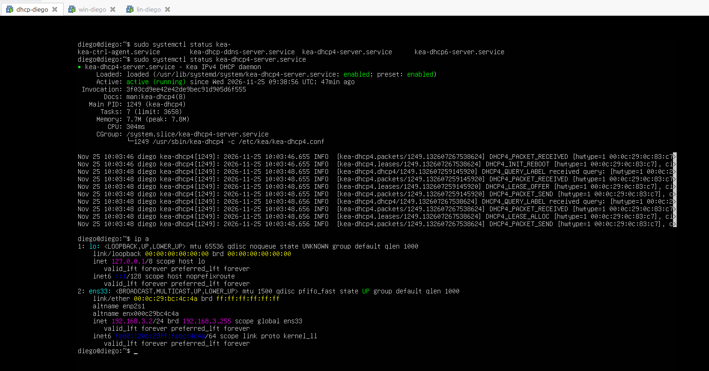
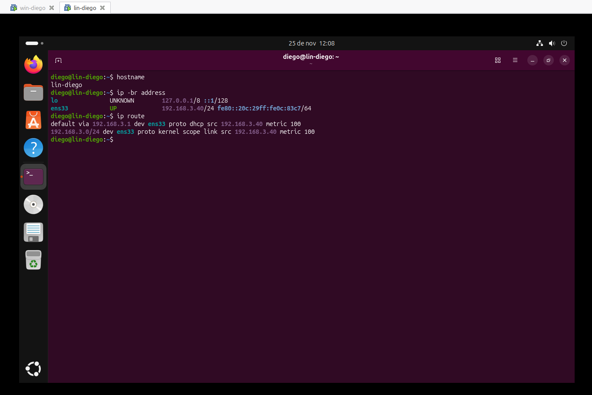
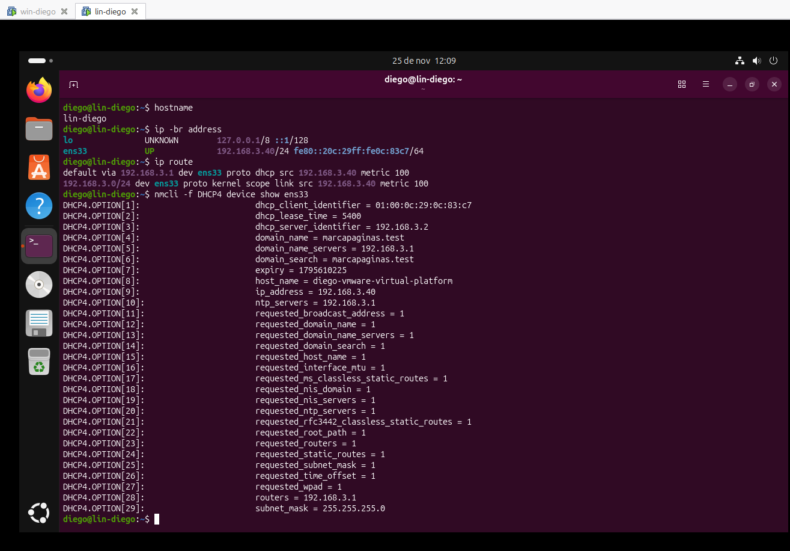
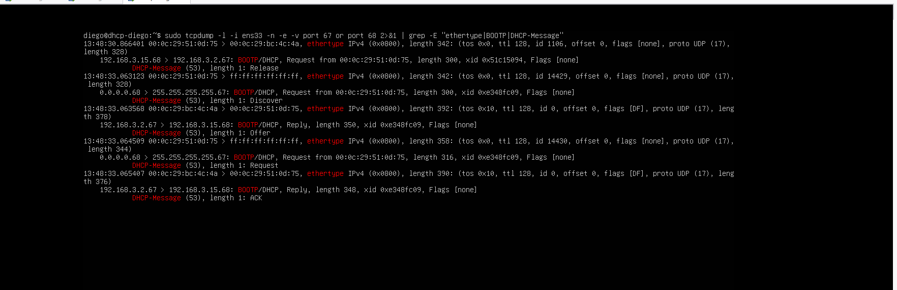
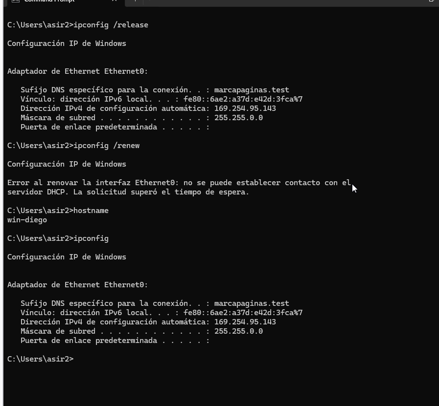

# UT2 · Servicio DHCP de Libreria El Marcapaginas

| Dato | Valor |
|---|---|
| Nombre | Diego|
| Nº de orden (xx) | 3|
| Empresa | Libreria el marcapaginas|
| Dominio | marcapaginas.test|

> Rellena los huecos y sustituye los textos entre `< >`. No cambies el orden de los apartados: es el mismo que el de la lista de cotejo.

## Plan de direcciones

| Equipo | Hostname | MAC | Dirección IP | Cómo la obtiene |
|---|---|---|---|---|
| Router pfSense (LAN) | pfsense-diego| fe80::20c:29ff:fe13:cf90 | 192.168.3.1 | Manual |
| Servidor DHCP | dhcp-diego | fe80::20c:29ff:febc:4c4a/64| 192.168.3.2 | Manual (fija) |
| Equipo de dirección (Windows) | win-diego | 00:0C:29:51:0D:75 |192.168.3.100| Ip reservada|
| Puesto de trabajo (Linux) | lin-diego | fe80::20c:29ff:fe0c:83c7/64 | 192.168.3.40| Ip dinámica| 

| Parámetro | Valor |
|---|---|
| Pools | .40 - .140|
| Exclusión | .80 - .85|
| Concesión / T1 / T2 (s) | 5400|
| DNS del equipo de dirección | 8.8.8.8|

## 1. Instalación del servidor · CE 2.c

**Qué demuestra:** En esta captura encontramos arriba a la izquierda el hostname de la maquina que es llama dhcp-diego, arriba podemos ver que el servidor kea esta activo y funcionando y debajo podemos ver la ip configurada.

## 2. Configuración básica · CE 2.d

La configuración completa está en [kea/kea-dhcp4.conf](kea/kea-dhcp4.conf).

**Qué demuestra:** En esta captura se demuestra que el servidor kea esta activo y funcionando.

**Qué demuestra:** En esta captura podemos ver que el hostname de la maquina es lin-diego, que la ip esta dentro de la pool y que se llama ens33.

**Qué demuestra:** En esta captura se puede ver que el servidor que responde es el kea que esta funcionando.

## 3. Asignaciones dinámicas y estáticas · CE 2.e

**Qué demuestra:** En esta captura se demuestra que el equipo Windows recibió la ip reservada del Kea. También podemos ver que el hostname esta cambiado.

**Qué demuestra:** En esta captura podemos ver el que el Kea ha registrado las concesiones por parte del leases4.csv y del jorunal con el lease_alloc

## 4. Opciones adicionales · CE 2.f

Se comprueban en `kea-dhcp4.conf` (con el comentario junto a la reserva), E4 y E5. No hace falta nada más aquí.

## 5. Así funciona una solicitud · CE 2.b

**Qué demuestra:** Esta captura demuestra el intercambio completo con la MAC de Windows y la del servidor.

| Mensaje | IP origen | MAC origen | IP destino | MAC destino | Difusión o unicast |
|---|---|---|---|---|---|
| DISCOVER | 0.0.0.0| 00:0c:29:51:0d:75| 255.255.255.255| ff:ff:ff:ff:ff| Difusión|
| OFFER | 192.168.3.2| 00:0c:29:bc:4c:4a| 192.168.3.15| 00:0c:29:51:0d:75| Unicast|
| REQUEST | 0.0.0.0| 00:0c:29:51:0d:75| 255.255.255.255| ff:ff:ff:ff:ff:ff| Difusión|
| ACK | 192.168.3.2| 00:0c:29:bc:4c:4a| 192.168.3.15 | 00:0c:29:51:0d:75| Unicast|

- **xid:** 0xe348fc09
- **Identificador del servidor:** 192.168.3.2

**Renovación y caducidad** (con tus tiempos, 3 o 4 líneas):
La concesión dura 5400 segundos, es decir, 90 minutos. Cuando llega a la mitad, la máquina Windows pide renovar solo con el request. Si el servidor no contesta, el cliente a los 79 minutos difundirá la petición anterior a todos los servidores DHCP para poder renovar con cualquiera y si pasa de los 80 minutos la concesión caduca y el cliente empieza de 0 con el DISCOVER.

## 6. Informe para la empresa · CE 2.a

**Tres ventajas para <empresa>:**

1. El fin de las IPs duplicadas: El kea reparte cada dirección una sola vez y lleva el registro de todas las concesiones.
2. Cambiar la mesa sin quedarse sin red: Al conectar el equipo en otro puesto recibe la ip automáticamente sin necesitar a alguien de soporte
3. Visitantes conectados sin configurar: Clientes y proveedores obtienen una ip al conectarse sin que nadie les tenga que dar datos de red.

| Mecanismo | Cómo obtiene el equipo su IP | Qué equipo de la oficina lo usa (en APIPA, cuándo aparece) |
|---|---|---|
| Configuración manual | La escribe el administrador en el propio equipo| pfSense (192.168.3.1) y dhcp-diego (192.168.3.2)|
| DHCP dinámica | Kea le presta una IP de los pools (.40-.79 y .86-.140) durante 5400 s| lin-diego y los equipos de los visitantes|
| Reserva DHCP | Kea le entrega siempre la misma IP, identificándolo por su MAC| win-diego (192.168.3.15)|
| APIPA (169.254.x.x) | El propio equipo se asigna una IP del rango 169.254.0.0/16| win-diego con Kea detenido (169.254.95.143)|

**Por qué el router y el servidor DHCP no usan DHCP:** El servidor DHCP es quien reparte las direcciones, así que no puede pedírsela a sí mismo, y necesita una IP fija y conocida para que los clientes lo localicen y para que Kea pueda escuchar siempre en esa dirección.

**Qué demuestra:** Esta captura demuestra que el Kea ha sido detenido y que si no hay servidor DHCP el equipo se configura solo.

## 7. Uso de IA

| Herramienta | Para qué la usé | Qué comprobé o corregí yo |
|---|---|---|
| Cloude | Para corregir errores que me salian en las configuraciones | Cuando me salia el kea inactivo|
